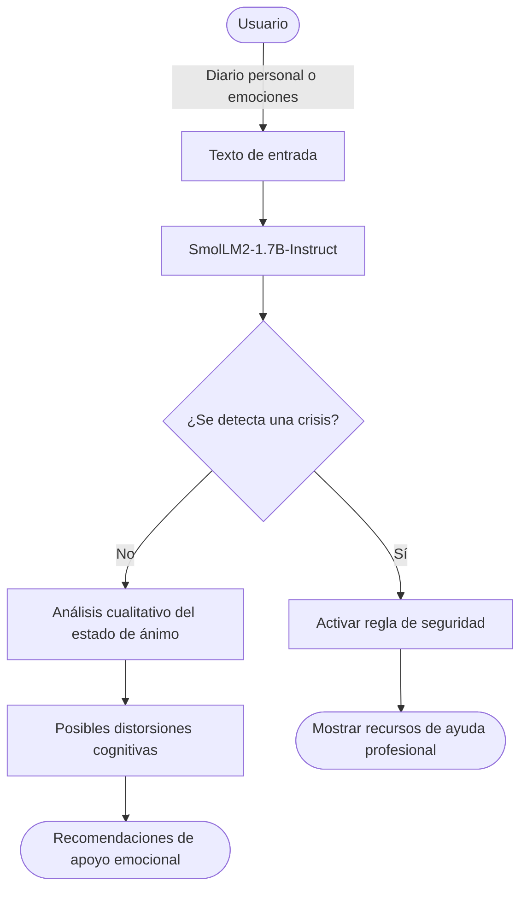
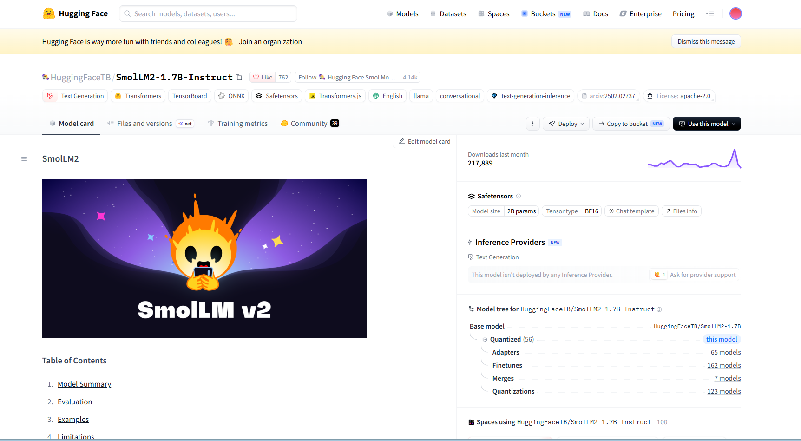

# Sistema de apoyo emocional para jóvenes universitarios

  

> Herramienta de autorreflexión que analiza textos sobre cómo se siente una persona, identifica posibles distorsiones cognitivas y ofrece recomendaciones de apoyo emocional o canalización profesional.

  

**Proyecto integrador · Herramientas de IA**

  

**Grupo:** A1 · **Equipo:** 3

  

##  Integrantes

| Nombre completo |
|-----------------|
| Fernanda Monterrubio Negrete |
| lan alejandro Maciel Romo |
| Jose Arturo Amaro Casillas |
| Paola Romina Meza Lopez |

## 1. Caso de uso

  

El sistema busca facilitar el acceso inmediato a herramientas de autorreflexión y detección temprana de crisis emocionales para jóvenes universitarios con altos niveles de estrés. La persona proporciona fragmentos de su diario personal o un texto sobre cómo se siente durante el día. El sistema devuelve un análisis cualitativo del estado de ánimo, identifica posibles distorsiones cognitivas y ofrece recomendaciones personalizadas de apoyo emocional o canalización a ayuda profesional.

  

- **Entrada:** fragmentos de un diario personal o texto que describa cómo se siente la persona.

- **Salida:** análisis cualitativo del estado de ánimo, posibles distorsiones cognitivas y recomendaciones de apoyo.

 
## 🔀 Cómo funciona  


## 2. Modelo abierto elegido

  

| Dato                         | Respuesta                                                                                                                                                                           |
| ---------------------------- | ----------------------------------------------------------------------------------------------------------------------------------------------------------------------------------- |
| Identificador                | [HuggingFaceTB/SmolLM2-1.7B-Instruct](https://huggingface.co/HuggingFaceTB/SmolLM2-1.7B-Instruct)                                                                                   |
| Tarea (pipeline tag)         | `text-generation`                                                                                                                                                                   |
| Número de parámetros         | 1.71 mil millones (1.7B)                                                                                                                                                            |
| Licencia                     | Apache 2.0                                                                                                                                                                          |
| Limitación o sesgo declarado | Por sus datos de entrenamiento procedentes de contenido web, puede generar respuestas sesgadas o no óptimas en temas sensibles. No sustituye el asesoramiento médico o profesional. |

  

## 3. Viabilidad de hardware

  

La memoria mínima estimada para cargar el modelo en precisión FP16 se calcula multiplicando el número de parámetros por 2 bytes por parámetro.

```

$$

\text{Memoria mínima} = 1.71\times 10^9\ \text{parámetros}\times 2\ \text{bytes}

$$

  

$$

\text{Memoria mínima} = 3.42\times 10^9\ \text{bytes} \approx 3.4\ \text{GB}

$$

```

- **GPU prevista:** NVIDIA T4 de Google Colab gratuito, con 15 GB de VRAM según la ficha técnica del proyecto.

- **Dónde se ejecuta:** Google Colab con la librería `transformers`.

- **Por qué:** la memoria disponible cubre la estimación de los pesos del modelo y deja espacio para memoria adicional de inferencia, aunque el consumo real puede variar.

  

## 4. Riesgo ético

  

- **Riesgo (responsabilidad ante un error):** el modelo podría ofrecer una evaluación equivocada o no reconocer una situación emocional grave.

- **Mitigación:** implementar una regla de seguridad que detecte señales de crisis e interrumpa la generación para mostrar opciones de ayuda profesional y números de emergencia pertinentes. Incluir una advertencia visible de que el sistema no es un terapeuta humano.

  

## 5. Evidencia

  

**Modelo:** [Model Card de SmolLM2-1.7B-Instruct en Hugging Face](https://huggingface.co/HuggingFaceTB/SmolLM2-1.7B-Instruct).

  

**Prueba del modelo:** se propone ingresar un texto de ejemplo en el que una persona universitaria exprese estrés académico y preocupación por sus resultados, y revisar si la respuesta es cuidadosa, no diagnóstica y recomienda buscar apoyo humano cuando sea necesario.

  
  

**Nota de seguridad:** esta herramienta es de apoyo y autorreflexión; no debe presentarse como diagnóstico ni como sustituto de atención profesional. Si detecta una posible crisis, debe priorizar recursos de ayuda humana.

